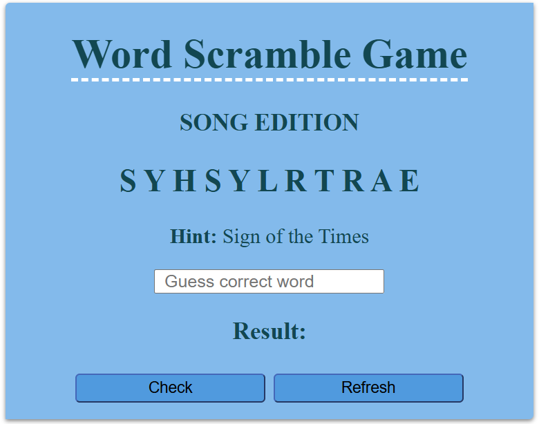
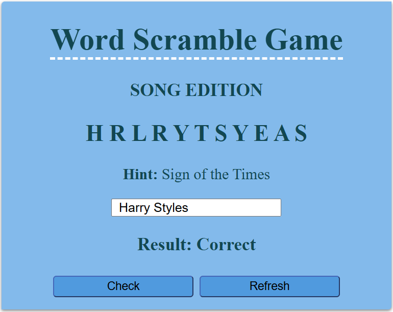

## Project Submission - Shaza Nouphal

### Overview
Word Scramble Game: Song Edition is a straightforward puzzle game where players unscramble a jumbled set of letters to find a hidden word, using a provided clue for assistance. Players receive an immediate "correct" or "incorrect" response based on their guess.

### Pre-requisites
- HTML
- CSS
- Js

### Demostration

